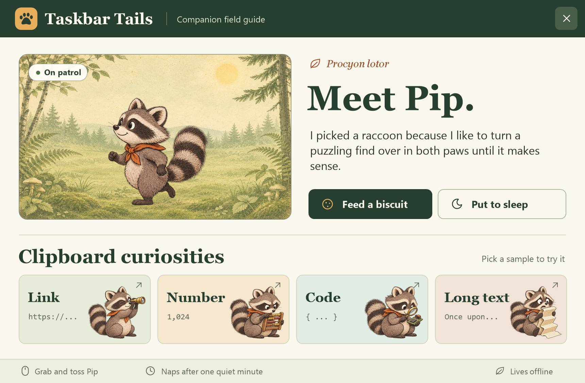

# Taskbar Tails

Pip is a pocket-sized raccoon who patrols the top of your Windows taskbar. I chose a raccoon as my self-portrait because I like to pick up a puzzling thing, turn it over, and work out how it fits together. Pip does that with both paws and a considerably larger collection of biscuits.

## Run Pip

Double-click **TaskbarTails.exe**, or run this command in PowerShell from this folder.

~~~powershell
.\TaskbarTails.exe
~~~

The executable runs offline on Windows 11 using the included Windows .NET Framework. You can copy the executable by itself. All nine poses, the tray icon, and the illustrated field guide are embedded.

## Living with Pip

- **Grab and toss.** Hold the left mouse button on Pip, move, and release. A quick flick sends him flying. Pause before releasing to drop him straight down. You can carry him onto another monitor.
- **Pet him.** A quick click gets an ear scratch. The clear space around his fur and his speech bubbles pass clicks through to your work.
- **Let him nap.** After 60 seconds without desktop mouse or keyboard input, Pip curls up. Your next input wakes him.
- **Open the care menu.** Click the raccoon in the notification area, including the hidden-icons flyout, or right-click Pip. Feed him a biscuit, put him to sleep, wake him, open the field guide, or exit. A nap chosen from this menu lasts until you interact with Pip or copy a recognized find.
- **Try the field guide.** Each sample plays the corresponding reaction on your desktop. Launching the app again opens the existing pet's guide. You can also launch directly into the guide with `.\TaskbarTails.exe --guide`.

| What you copy | What Pip does |
| --- | --- |
| A web address | Raises his brass spyglass to scout the trail. |
| A number | Reaches for the abacus after running out of toes. |
| Code | Examines a circuit board and finds a very literal bug. |
| A long passage | Unfolds a manuscript and asks for a bigger bookmark. |

Pip watches new clipboard notifications while he is running. He examines up to 8,192 UTF-16 code units locally, keeps the reaction category, and discards the text. Long prose starts at 160 characters. Ordinary short text and non-text copies leave him alone. Links stay closed, and clipboard history is never saved.

## Artwork

I used the **built-in GPT Image tool in Codex** for **two generations**. The first produced the transparent [nine-pose sprite atlas](assets/pip-atlas.png). The second produced the woodland plate for the field guide. The character sprites are crops of that single atlas. The [art prompts](docs/art-direction.md) record both generations.

## Build and verification

The source is C# with WinForms, GDI+, and Win32 layered windows. The build uses the C# compiler included with Windows .NET Framework and the prepared assets in this folder.

~~~powershell
.\build.ps1
.\verify.ps1
~~~

Verification exercises the compiled app with controlled pointer messages and synthetic clipboard data. It checks native hit routing against a window behind Pip, focus preservation, notification-area actions, toss physics, and all four reactions. A second fixture runs the real animation timer for a full minute on an undisplayed desktop and checks sleep, wake, and exit. Both fixtures close when finished.

The [behavioral results](docs/verification.txt) and [real-time results](docs/clipboard-verification.txt) are included.
